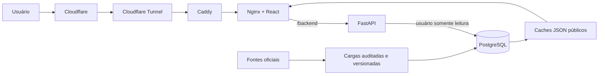

# Radar Goiano

[](https://radargoiano.com)
[](https://github.com/davy-mota/Radar-Goiano/actions/workflows/deploy.yml)
[](https://react.dev/)
[](https://fastapi.tiangolo.com/)
[](https://www.postgresql.org/)

Plataforma de transparência e análise de gastos públicos do Estado de Goiás.
O Radar Goiano reúne bases oficiais dispersas, aplica controles de qualidade e
transforma registros financeiros em visualizações explicáveis para cidadãos,
pesquisadores e profissionais de controle social.

**Acesse:** [radargoiano.com](https://radargoiano.com)

> O sistema é uma ferramenta de consulta e triagem. Rankings, diferenças e
> alertas não comprovam irregularidade. Toda conclusão exige verificação do
> contexto e dos documentos na fonte oficial.

## O que o projeto oferece

- resumo cidadão com leitura guiada dos principais indicadores;
- exploração de empenhos, liquidações e pagamentos;
- análise de orçamento, receita e políticas públicas;
- comparação de órgãos e exercícios;
- perfil de fornecedores com pagamentos e contratos associados;
- contratos, folha de pagamento, diárias e passagens;
- repasses municipais, indicadores per capita e mapa dos 246 municípios;
- emendas parlamentares estaduais;
- despesas de deputados federais, senadores e deputados estaduais;
- perfil do Governador com remuneração e contexto da Governadoria;
- alertas explicáveis, qualidade dos dados e histórico de cargas;
- exportação rastreável dos resultados consultados;
- temas claro e escuro com componentes visuais responsivos.

## Princípios analíticos

O projeto foi construído com quatro preocupações centrais:

1. **Rastreabilidade:** fontes, períodos e limitações acompanham os resultados.
2. **Separação semântica:** contrato, orçamento, empenho, liquidação e pagamento
   não são tratados como se representassem a mesma grandeza.
3. **Qualidade dos dados:** cargas são auditadas, versionadas e ativadas somente
   depois das validações.
4. **Comunicação responsável:** indicadores direcionam investigação, mas não são
   apresentados como acusações ou diagnósticos automáticos.

## Fontes de dados

Entre as fontes oficiais utilizadas estão:

- [Portal de Dados Abertos do Estado de Goiás](https://dadosabertos.go.gov.br/);
- [Portal da Transparência do Estado de Goiás](https://transparencia.go.gov.br/);
- [Assembleia Legislativa do Estado de Goiás — Alego](https://portal.al.go.leg.br/);
- [Câmara dos Deputados — CEAP](https://www.camara.leg.br/cota-parlamentar/);
- [Senado Federal — CEAPS](https://www12.senado.leg.br/transparencia/dados-abertos-transparencia/dados-abertos-ceaps);
- [IBGE](https://www.ibge.gov.br/), para códigos, população e malha municipal.

A cobertura varia conforme a disponibilidade de cada fonte. Ausência de registro
é apresentada como ausência na base consultada, nunca convertida automaticamente
em valor igual a zero.

## Arquitetura



O ambiente de produção utiliza cinco serviços permanentes:

| Serviço | Responsabilidade |
| --- | --- |
| PostgreSQL | armazenamento analítico e versionamento das cargas |
| FastAPI/Uvicorn | consultas, agregações e contratos HTTP |
| React/Nginx | interface e entrega dos arquivos estáticos |
| Caddy | gateway interno e roteamento entre frontend e API |
| Cloudflare Tunnel | publicação sem exposição direta da origem |

Um contêiner de manutenção configura o usuário somente leitura da API durante o
deploy e não permanece ativo.

## Tecnologias

**Frontend:** React 19, Vite 8, Tailwind CSS, Recharts e Lucide.

**Backend e dados:** Python 3.13, FastAPI, SQLAlchemy, pandas e PostgreSQL 18.

**Qualidade:** unittest, Playwright, Cypress, ESLint e validações de carga.

**Infraestrutura:** Docker Compose, Nginx, Caddy, Cloudflare Tunnel e GitHub
Actions.

## Estrutura do repositório

```text
Radar-Goiano/
├── backend/                  API, cargas, auditoria e testes
│   ├── controllers/          rotas HTTP por domínio
│   ├── migrations/           evolução versionada do banco
│   └── tests/                testes unitários e de integração
├── frontend/radar-front/     aplicação React/Vite
├── deploy/                   Caddy, Nginx e artefatos de infraestrutura
├── docs/                     documentação técnica e memorial do TCC
├── scripts/                  automação local e implantação no VPS
├── compose.prod.yml          composição do ambiente de produção
├── Dockerfile.api
└── Dockerfile.web
```

## Execução local

### Pré-requisitos

- Python 3.13;
- Node.js 22 e npm;
- PostgreSQL 18;
- Git.

### 1. Clonar e configurar o ambiente

```powershell
git clone https://github.com/davy-mota/Radar-Goiano.git
cd Radar-Goiano
Copy-Item .env.example .env
```

Edite `.env` e ajuste `DATABASE_URL` para a sua instância local. Nunca reutilize
senhas de produção nem envie o arquivo `.env` ao Git.

### 2. Iniciar a API

```powershell
python -m venv .venv
.\.venv\Scripts\Activate.ps1
python -m pip install --upgrade pip
pip install -r requirements.txt
Set-Location backend
python -m uvicorn main:app --reload --host 127.0.0.1 --port 8000
```

A API fica disponível em `http://127.0.0.1:8000`. No desenvolvimento, a
documentação interativa fica em `http://127.0.0.1:8000/docs`.

### 3. Iniciar o frontend

Em outro terminal:

```powershell
Set-Location frontend/radar-front
npm ci
npm run dev -- --host 127.0.0.1 --port 5173
```

A interface fica disponível em `http://127.0.0.1:5173`.

> A aplicação depende do esquema e dos dados no PostgreSQL. Consulte a
> [documentação do backend](backend/README.md) para cargas e atualização dos
> caches. Dumps e credenciais não fazem parte do repositório.

## Testes e validações

### Backend

```powershell
Set-Location backend
python -m unittest discover -s tests -p "test_*.py"
python -m compileall -q .
```

Alguns testes de integração são ignorados quando não existe uma base PostgreSQL
compatível e com versão ativa.

### Frontend

```powershell
Set-Location frontend/radar-front
npm run lint
npm run build
npm run test:e2e
```

## Cargas e atualização dos dados

As importações principais são executadas pelo controlador auditado:

```powershell
Set-Location backend
python executar_carga.py pagamentos
python executar_carga.py receitas
python executar_carga.py contratos
python executar_carga.py folha
python executar_carga.py diarias
```

Para atualizar os caches JSON após uma importação:

```powershell
python gerar_cache.py
```

As cargas financeiras versionadas são preparadas e validadas antes da ativação.
Uma versão anterior pode ser restaurada sem apagar os fatos históricos. Os
procedimentos completos estão descritos em
[Auditoria e Qualidade dos Dados](docs/AUDITORIA_QUALIDADE_DADOS.md).

## Privacidade e apresentação responsável

Os dados brutos permanecem preservados para auditoria. Nos caches públicos de
Folha e Diárias, nomes de servidores que não exercem cargos políticos de alta
exposição são minimizados: o primeiro nome é preservado e os sobrenomes são
reduzidos à inicial e asteriscos. Governadores, deputados e senadores permanecem
identificados, assim como órgãos e pessoas jurídicas.

Documentos pessoais não são publicados integralmente nas exportações. As telas
também apresentam ressalvas de interpretação adequadas a cada conjunto de dados.

## Acessibilidade

O site integra o [VLibras Widget](https://vlibras.gov.br/app/) para tradução
automática de português brasileiro para Libras. Também oferece link para pular a
navegação, foco visível, identificação semântica das regiões, controles com nomes
acessíveis, anúncios de carregamento, indicação da seção atual e suporte às
preferências de movimento reduzido e alto contraste do sistema.

Esses recursos ampliam o acesso, mas não representam uma declaração automática
de conformidade integral com as WCAG. Traduções, textos alternativos e fluxos de
uso devem continuar sendo avaliados com tecnologias assistivas e pessoas com
deficiência.

## Segurança e produção

Em produção, o banco não publica porta na Internet e a API utiliza um usuário
exclusivo com acesso somente leitura. A origem é alcançada por um túnel de saída,
enquanto rate limiting, limites de conexão, cabeçalhos de segurança, CORS e
validação de host reduzem a superfície de ataque.

O fluxo automatizado valida lint, build e compilação Python antes de autorizar a
publicação. As instruções de infraestrutura, backup e atualização estão em
[Deploy na DigitalOcean](docs/DEPLOY_DIGITALOCEAN.md).

## Documentação

- [Plano Técnico de Evolução](docs/PLANO_TECNICO_EVOLUCAO.md)
- [Memorial de Implementação do TCC](docs/MEMORIAL_IMPLEMENTACAO_TCC.md)
- [Auditoria e Qualidade dos Dados](docs/AUDITORIA_QUALIDADE_DADOS.md)
- [Relato de Implantação em Produção](docs/RELATO_IMPLANTACAO_PRODUCAO_TCC.md)
- [Roadmap de Dados Relevantes](docs/ROADMAP_DADOS_RELEVANTES.md)
- [Backend e Cargas](backend/README.md)

## Limitações

- a cobertura histórica não é uniforme entre todas as bases;
- portais oficiais podem alterar formatos, campos ou disponibilidade;
- vínculos entre conjuntos somente são apresentados quando existe identificador
  suficientemente confiável;
- valores nominais de exercícios diferentes não equivalem a valores corrigidos
  pela inflação;
- um valor elevado, isoladamente, não demonstra desperdício ou irregularidade;
- vereadores ainda não possuem cobertura centralizada, pois as 246 câmaras
  municipais não oferecem uma base estruturada única.

## Contexto acadêmico

O Radar Goiano é desenvolvido como Trabalho de Conclusão de Curso e busca
demonstrar como engenharia de dados, desenvolvimento web e visualização podem
ampliar a compreensão de informações públicas sem eliminar suas limitações e
incertezas.

## Licenciamento

Este repositório ainda não possui uma licença de reutilização. A disponibilidade
do código no GitHub não concede automaticamente permissão para redistribuição ou
uso comercial. Entre em contato com o autor antes de reutilizar partes do projeto.
