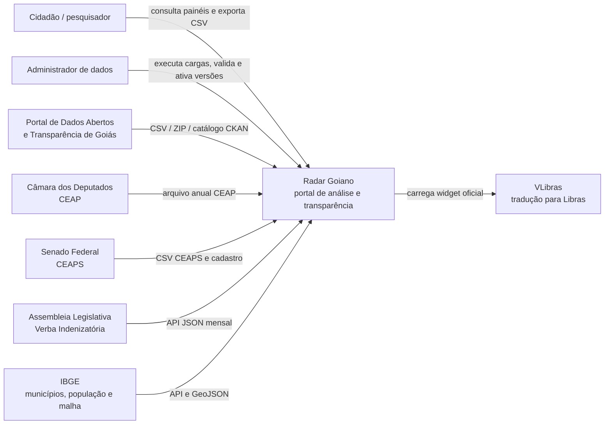
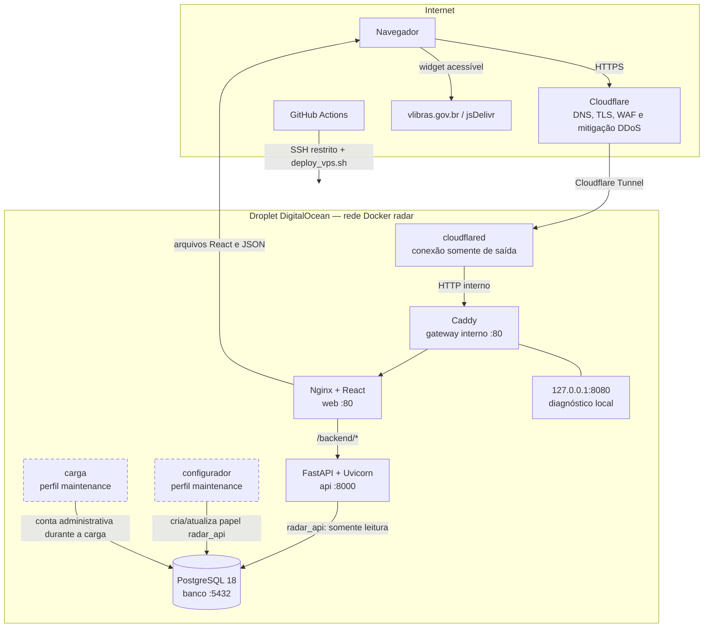
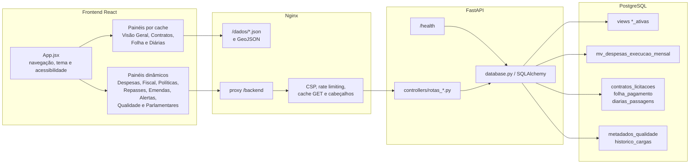
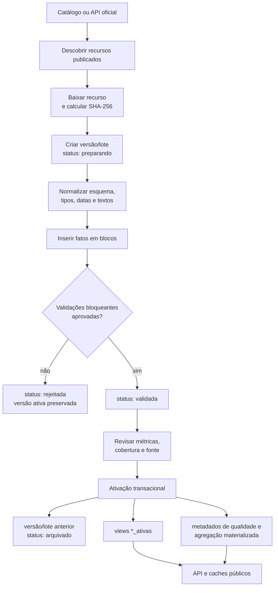
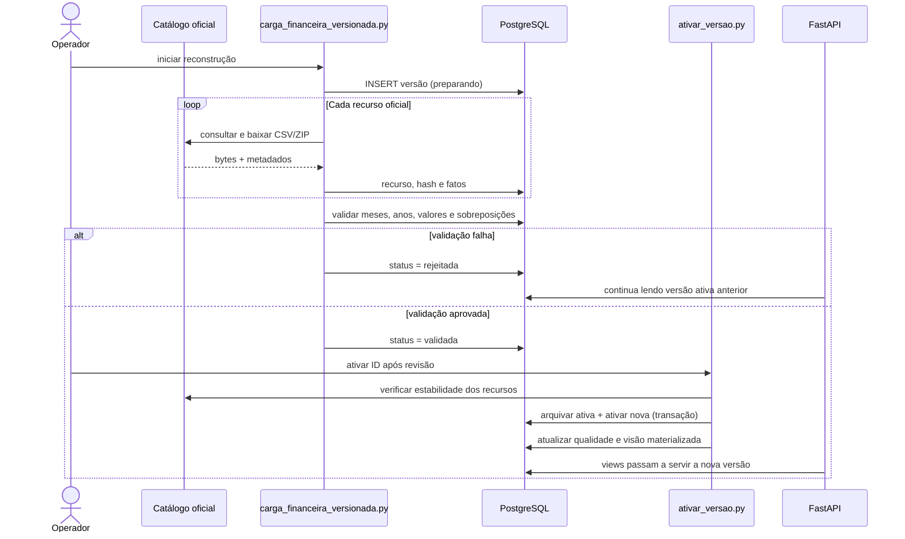
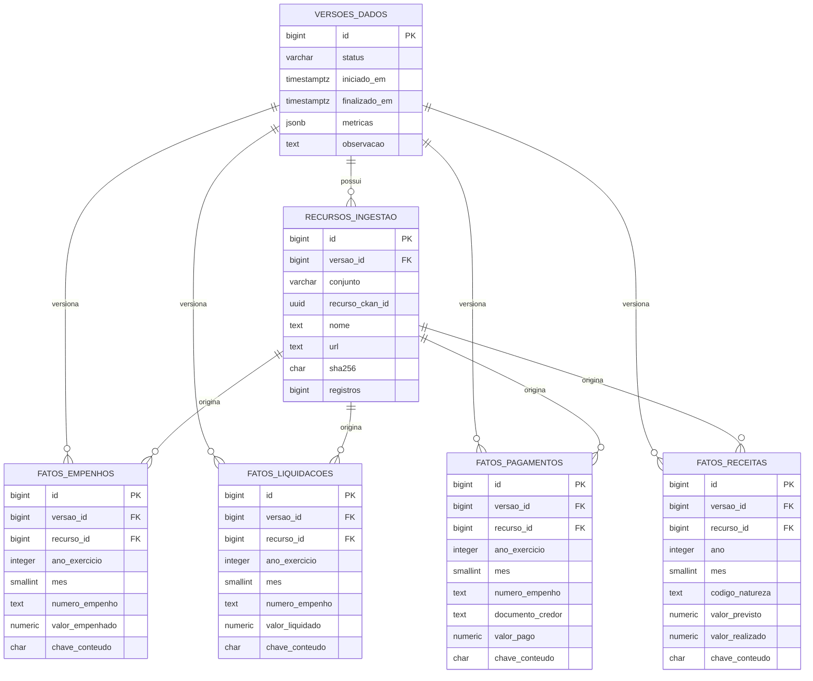
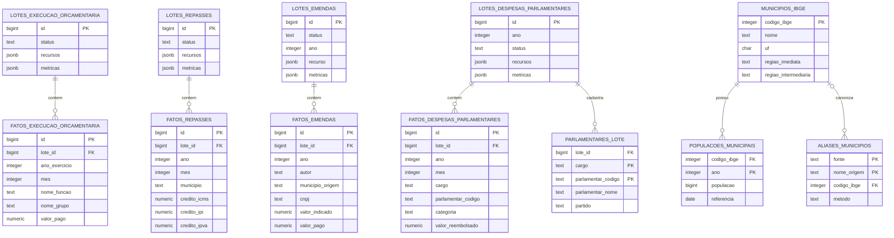
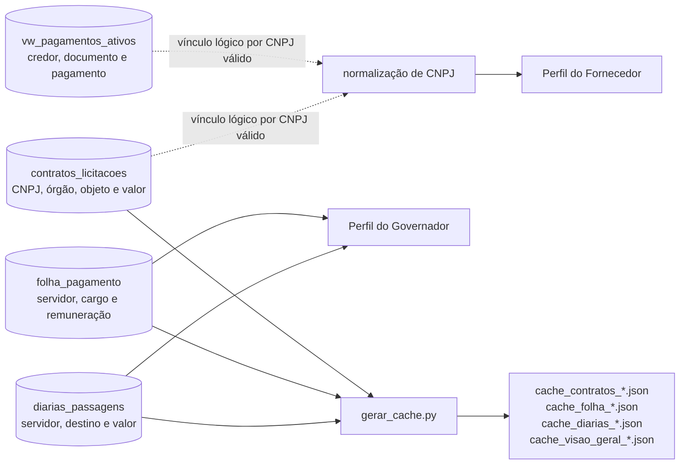
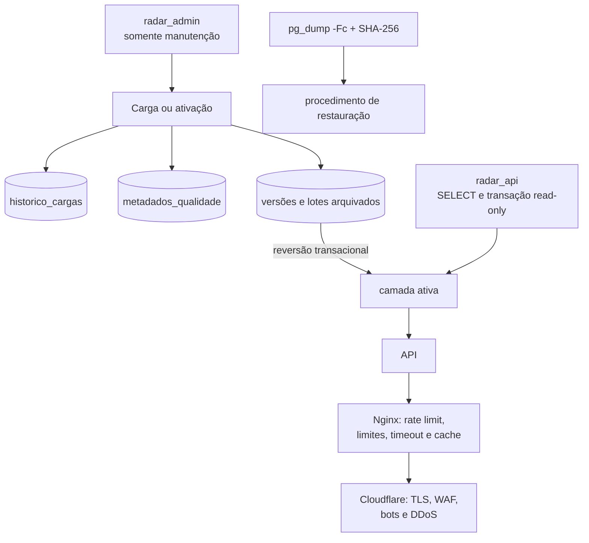

# Diagramas de arquitetura e modelagem do Radar Goiano

## 1. Finalidade e método

Este documento representa a arquitetura **realmente implementada** no Radar
Goiano em 2 de novembro de 2026. Os diagramas foram derivados dos seguintes
artefatos versionados:

- `compose.prod.yml`, `Dockerfile.api`, `Dockerfile.web` e `Dockerfile.carga`;
- `deploy/Caddyfile`, `deploy/nginx.conf` e `scripts/deploy_vps.sh`;
- `backend/main.py`, `backend/controllers/` e os carregadores `carga_*.py`;
- migrações SQL de `backend/migrations/008` a `020`;
- componentes React e chamadas HTTP em `frontend/radar-front/src/`.

Não são incluídos serviços planejados ou relações que não existam no código ou
no banco. Relações lógicas sem chave estrangeira são identificadas como tal.

Para uso no TCC, a legenda recomendada é: **Fonte: elaborado pelo autor com base
na implementação do Radar Goiano (2026).**

## 2. Diagrama de contexto do sistema

**Figura 1 — Contexto, usuários e fontes externas.**

O usuário público não grava dados. A administração é um processo operacional
separado, executado somente durante cargas, migrações e implantação.

## 3. Arquitetura de implantação em produção

**Figura 2 — Contêineres, fronteiras de rede e publicação.**

Os serviços `configurador` e `carga` pertencem ao perfil `maintenance`: são
criados sob demanda e removidos ao terminar. PostgreSQL, API e aplicação não
publicam portas no IP externo. A única porta de administração do firewall é SSH,
restrita ao IP autorizado; `127.0.0.1:8080` não aceita conexões externas.

## 4. Componentes de software e caminhos de consulta

**Figura 3 — Relação entre interface, cache, API e banco.**

Essa divisão explica por que algumas telas dependem de regeneração de cache e
novo build, enquanto outras refletem imediatamente a versão ativa no banco.

## 5. Fluxo de ingestão, validação e publicação

**Figura 4 — Pipeline de dados auditável.**

A camada financeira usa uma versão global. Execução classificada, repasses,
emendas e despesas parlamentares usam lotes próprios. Em ambos os casos, a
versão anterior permanece disponível para reversão e a troca de estado ocorre em
transação.

## 6. Sequência de uma atualização financeira

**Figura 5 — Separação entre preparar e ativar.**

Não existe ativação automática no fim da carga financeira. Essa decisão reduz o
risco de publicar uma reconstrução sem revisão das métricas.

## 7. Modelo de dados financeiro versionado

**Figura 6 — Entidades da camada financeira principal.**

As quatro views `vw_empenhos_ativos`, `vw_liquidacoes_ativas`,
`vw_pagamentos_ativos` e `vw_receitas_ativas` filtram fatos pela única versão com
status `ativa`. Empenho, liquidação e pagamento compartilham identificadores
publicados, mas não possuem chave estrangeira direta: os grãos e a qualidade dos
identificadores da fonte não garantem relação linha a linha.

## 8. Modelo dos domínios analíticos por lote

**Figura 7 — Lotes independentes e dimensão municipal.**

`vw_repasses_municipais_canonicos` liga repasses, aliases, município e população
para calcular valor por habitante. `vw_emendas_ativas` usa a mesma dimensão para
conciliar o município publicado na emenda. A tabela de parlamentares preserva
também pessoas cadastradas sem documento no período, evitando transformar
ausência na fonte em gasto zero.

## 9. Dados legados, caches e vínculos lógicos

**Figura 8 — Tabelas importadas e associações sem chave estrangeira.**

O Perfil do Fornecedor não relaciona registros por semelhança de nome. O vínculo
é calculado por CNPJ normalizado e válido, mas não existe uma chave estrangeira
entre contratos e pagamentos. Folha e diárias também permanecem em tabelas
independentes; o perfil do Governador aplica filtros funcionais explícitos.

## 10. Observabilidade, segurança e recuperação

**Figura 9 — Controles operacionais ao redor dos dados.**

O backup físico e a reversão de versão resolvem problemas diferentes: a reversão
troca rapidamente a camada publicada; o dump permite recuperação diante de perda
ou corrupção do banco inteiro.

## 11. Limites dos diagramas

- Os diagramas mostram entidades e campos estruturantes, não todas as colunas.
- Views e índices aparecem quando alteram o comportamento arquitetural.
- O PostgreSQL contém versões arquivadas e rejeitadas; as APIs consultam apenas
  views ativas ou lotes ativos.
- A associação entre fornecedor, contrato e pagamento é lógica por documento e
  deliberadamente não foi desenhada como integridade referencial.
- O widget VLibras é um serviço externo de acessibilidade e não participa do
  processamento financeiro.
