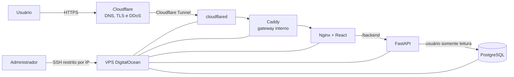

# Relato técnico da implantação do Radar Goiano em produção

## 1. Finalidade deste documento

Este relato consolida as decisões, os procedimentos, os problemas encontrados e
as evidências de validação da implantação do Radar Goiano em ambiente público.
O texto pode ser adaptado para os capítulos de metodologia, desenvolvimento,
resultados e considerações sobre segurança do Trabalho de Conclusão de Curso.

A implantação foi concluída em outubro de 2026 e disponibilizou o sistema no
domínio `https://radargoiano.com`. Credenciais, tokens, endereços administrativos
e demais segredos operacionais foram deliberadamente omitidos.

## 2. Objetivo da implantação

O objetivo foi transformar a aplicação, até então executada em ambiente local,
em um serviço público, reproduzível e protegido, preservando três requisitos:

1. disponibilizar frontend, API e dados por um único domínio HTTPS;
2. impedir a exposição direta da API e do PostgreSQL à Internet;
3. permitir novas versões sem reconstrução manual de toda a infraestrutura.

Também foram considerados riscos de indisponibilidade, negação de serviço,
esgotamento de conexões, consultas excessivamente longas, exposição de
credenciais e acesso administrativo não autorizado.

## 3. Infraestrutura adotada

Foi utilizada uma VPS da DigitalOcean com Ubuntu 24.04 LTS, 2 vCPUs, 4 GB de
memória RAM e 80 GB de armazenamento SSD. Essa configuração foi escolhida por
acomodar a aplicação e a base PostgreSQL local, cujo volume observado era de
aproximadamente 22 GB, mantendo margem para imagens Docker, arquivo de backup,
índices e crescimento inicial.

O custo de referência no momento da decisão foi de US$ 24 por mês para a VPS,
sem incluir domínio e serviços opcionais de backup do provedor. O domínio foi
registrado na Hostinger e teve sua autoridade DNS transferida para a Cloudflare.

### 3.1 Componentes de produção

| Componente | Tecnologia | Responsabilidade |
|---|---|---|
| Borda pública | Cloudflare | DNS, HTTPS, mitigação de DDoS, proxy e conexão com o túnel |
| Túnel | `cloudflared` | conexão iniciada pela VPS, sem porta web pública de entrada |
| Gateway interno | Caddy | encaminhamento interno do túnel para o servidor web |
| Servidor web | Nginx | frontend React, proxy `/backend`, cache e limitação de requisições |
| Frontend | React/Vite | apresentação das análises e narrativas de dados |
| API | FastAPI/Uvicorn | consultas, agregações e contratos HTTP |
| Banco | PostgreSQL 18 | armazenamento dos dados governamentais e índices analíticos |
| Orquestração | Docker Compose | criação, isolamento, health checks e reinício dos serviços |

O serviço de configuração do banco é executado somente durante manutenção. Ele
cria ou atualiza o papel de leitura da API e não permanece ativo após o deploy.

## 4. Arquitetura resultante

O fluxo público não alcança diretamente o endereço IP da VPS. O processo
`cloudflared` abre conexões de saída para a rede da Cloudflare e entrega as
requisições ao gateway pela rede privada do Docker. A única entrada administrativa
permitida no Cloud Firewall é SSH, restrito ao endereço IP do administrador.

As portas 80, 443, 5432, 8000 e 8080 não são publicadas para a Internet. A porta
8080 fica vinculada exclusivamente a `127.0.0.1`, para diagnóstico e health check
local. O PostgreSQL e a API existem apenas na rede interna do Compose.

## 5. Empacotamento e reprodutibilidade

A API e o frontend receberam Dockerfiles independentes. O frontend é compilado
em uma etapa Node.js e servido por uma imagem final reduzida do Nginx. A API usa
uma imagem Python com dependências de produção separadas das ferramentas de
desenvolvimento.

O arquivo `compose.prod.yml` descreve os serviços, volumes persistentes, rede
privada, dependências e verificações de saúde. A configuração sensível é lida de
`.env.production`, arquivo ignorado pelo Git. O repositório contém somente
`.env.production.example`, com nomes das variáveis e valores fictícios.

O script `scripts/deploy_vps.sh` executa a sequência reproduzível:

1. construir as imagens;
2. iniciar e aguardar o PostgreSQL;
3. executar a configuração idempotente das permissões;
4. iniciar os serviços permanentes;
5. consultar o endpoint local de saúde;
6. apresentar logs quando a validação não é concluída.

Essa automação reduz diferenças entre implantações e torna uma atualização normal
compatível com `git pull` seguido da execução do script.

## 6. Separação de credenciais e privilégio mínimo

Foram criadas duas identidades de banco distintas:

- `radar_admin`: utilizada em restauração, migração e manutenção;
- `radar_api`: utilizada continuamente pela aplicação.

O papel da API recebe `CONNECT`, `USAGE` e `SELECT`, tem transações somente leitura
por padrão e timeout de consulta. A senha administrativa não é fornecida ao
contêiner permanente da API. O acesso administrativo é usado apenas pelo serviço
de manutenção e pelo procedimento de restauração.

As senhas de produção são diferentes entre si e o token do Cloudflare Tunnel é
armazenado somente na VPS. Nenhum desses valores é registrado no Git, na
documentação ou nas imagens Docker.

## 7. Controles de segurança

A estratégia adotada foi defesa em profundidade, isto é, controles complementares
em diferentes camadas:

### 7.1 Rede e borda

- Cloud Firewall permitindo somente SSH a partir do IP administrativo;
- ausência de portas públicas para frontend, API e PostgreSQL;
- Cloudflare Tunnel como único caminho público para a aplicação;
- HTTPS emitido e encerrado na borda da Cloudflare;
- mitigação de DDoS da Cloudflare e proteção de rede da DigitalOcean;
- Bot Fight Mode disponível na camada de borda.

### 7.2 Proxy e aplicação

- limite de 10 requisições por segundo por cliente, com rajada de 30;
- máximo de 20 conexões simultâneas por endereço;
- corpo de requisição limitado a 1 MiB;
- cache para respostas GET bem-sucedidas e trava contra consultas idênticas
  concorrentes;
- timeout de proxy e timeout de consulta no PostgreSQL;
- hosts aceitos e origens CORS configurados explicitamente;
- documentação OpenAPI desativada em produção;
- cabeçalhos HSTS, CSP, `X-Content-Type-Options`, `X-Frame-Options`,
  `Referrer-Policy` e `Permissions-Policy`.

### 7.3 Persistência e operação

- PostgreSQL sem porta publicada;
- papel permanente da API limitado à leitura;
- volumes Docker persistentes;
- health checks para banco e API;
- política de reinício dos contêineres;
- backup externo necessário mesmo quando o provedor oferece snapshot da VPS.

## 8. Migração do banco de dados

A migração foi realizada por backup lógico no formato customizado do PostgreSQL.
No ambiente local, `pg_dump` foi executado com compressão, sem transportar
proprietários ou ACLs da instalação original. Ao final, foi calculado SHA-256 do
arquivo.

O arquivo foi transferido por SFTP/SCP para uma pasta montada no contêiner do
banco. Antes da restauração, o hash foi calculado novamente na VPS e comparado ao
valor local, garantindo que o arquivo não foi alterado ou corrompido durante a
transferência.

Durante a restauração, os serviços consumidores foram interrompidos e o banco
permaneceu ativo. O `pg_restore` utilizou limpeza controlada, ausência de
proprietário e ACL, interrupção em erro e dois trabalhos paralelos, compatíveis
com as duas vCPUs contratadas. Depois da carga, o configurador foi executado
novamente para conceder leitura sobre todas as tabelas restauradas ao papel da
API.

Por fim, foram conferidos o endpoint de saúde, o estado dos contêineres e as
estimativas de registros em `pg_stat_user_tables`. O arquivo de backup foi mantido
até a validação funcional das telas.

## 9. Configuração do domínio

O domínio `radargoiano.com` foi registrado na Hostinger. Inicialmente, ele ainda
apresentava a página de estacionamento do registrador. Para tornar a Cloudflare
autoritativa, os nameservers antigos foram substituídos pelos dois nameservers
atribuídos à zona na Cloudflare, com DNSSEC antigo desativado durante a transição.

Após a propagação, o registro `A` que apontava para a página estacionada foi
removido. O domínio raiz passou a usar um registro do tipo Tunnel, associado ao
túnel `radar-goiano` e com proxy ativo. Não foi adotado subdomínio `www`, conforme
a decisão de usar um único endereço canônico.

O hostname público do túnel encaminha `radargoiano.com` para
`http://gateway:80`. O serviço interno utiliza HTTP porque a conexão pública TLS
é tratada pela Cloudflare e o tráfego até o conector percorre o túnel autenticado.

## 10. Problemas encontrados e correções

### 10.1 Arquivos de produção ausentes na VPS

Na primeira tentativa, o repositório remoto ainda não continha Dockerfiles,
Compose e scripts. A execução retornava “No such file or directory”. Os arquivos
foram revisados, validados, commitados e enviados ao repositório; em seguida, a
VPS recebeu a versão correta por `git pull`.

### 10.2 Divergência no histórico Git

O push inicial foi rejeitado porque a origem continha um commit de testes e caches
que não existia localmente. O histórico remoto foi buscado e integrado sem uso de
`force push`. Durante o merge foram detectados marcadores de conflito versionados
dentro de JSONs de cache. Esses arquivos corrompidos foram descartados, mantendo
os caches locais validados. As dependências de Playwright e Cypress foram
combinadas, e lint e build voltaram a passar.

### 10.3 API marcada como não saudável

O contêiner iniciava, mas o health check consultava `127.0.0.1`, enquanto a lista
de hosts de produção aceitava `localhost`. O middleware retornava HTTP 400 e o
Docker classificava a API como não saudável. A URL do health check foi alinhada
ao host permitido e `127.0.0.1` foi acrescentado ao exemplo de configuração.

### 10.4 Token inválido no Cloudflare Tunnel

O contêiner do túnel registrou “Provided Tunnel token is not valid”. O token
específico do túnel foi copiado novamente para `.env.production`. Como reiniciar
um contêiner não atualiza suas variáveis, o serviço foi recriado. A mensagem
“Registered tunnel connection” confirmou a autenticação.

### 10.5 Página estacionada da Hostinger

Mesmo com o túnel saudável, o domínio exibia a Hostinger porque a delegação ainda
usava os nameservers do registrador e havia um registro `A` para a página de
estacionamento. Após a troca dos nameservers, remoção do registro antigo e criação
da rota Tunnel, resolvedores públicos passaram a retornar endereços da Cloudflare.

O cache DNS local ainda apresentou a página anterior por algum tempo. Um teste
forçando a resolução para um endereço da Cloudflare retornou HTTP 200, cabeçalhos
de segurança, `Server: cloudflare`, passagem pelo Caddy e o endpoint da API com
estado online, demonstrando que a origem nova já estava funcional.

## 11. Validações e evidências

Foram utilizadas as seguintes verificações técnicas:

| Verificação | Resultado esperado/observado |
|---|---|
| Sintaxe do Compose e workflow | YAML válido |
| Compilação Python | módulos de produção sem erro de sintaxe |
| Lint do frontend | aprovado após configuração dos globais do Cypress |
| Build Vite | concluído com sucesso |
| Estado do PostgreSQL | `healthy` |
| Estado da API | `healthy` |
| Endpoint local | `/health` com API e banco online |
| Endpoint público | `/backend/health` com HTTP 200 |
| Página inicial pública | HTTP 200 pela Cloudflare |
| Documentação em produção | `/backend/docs` indisponível, conforme política |
| DNS autoritativo | nameservers da Cloudflare |
| Origem pública | domínio associado ao Tunnel, sem IP da VPS no DNS |
| Integridade do backup | hashes SHA-256 local e remoto comparáveis |

## 12. Resultado obtido

O Radar Goiano passou de uma aplicação local para um serviço web público e
reproduzível. A solução atende o domínio por HTTPS, mantém banco e API isolados,
reduz a superfície de ataque, diferencia credenciais administrativas e de leitura
e permite atualizações versionadas.

O resultado também demonstrou a importância da validação por camadas. Um
contêiner em execução não garante disponibilidade pública; foi necessário validar
aplicação, banco, proxy, túnel, DNS, certificado e caches de resolução. A sequência
de diagnóstico empregada durante a implantação tornou possível identificar cada
falha sem expor temporariamente a VPS ou desativar controles de segurança.

## 13. Limitações e trabalhos futuros

- a implantação utiliza uma única VPS e, portanto, não oferece alta
  disponibilidade contra falha integral do servidor;
- a restauração do backup ainda é um procedimento operacional e deve ser testada
  periodicamente;
- os limites de requisição devem ser observados com tráfego real para evitar
  bloqueios indevidos em redes compartilhadas;
- métricas, logs centralizados e alertas externos de disponibilidade podem ser
  ampliados;
- a rotação de senhas e do token do túnel deve fazer parte da manutenção;
- atualizações de imagens e dependências devem ser precedidas por backup e testes;
- uma política formal de retenção de backups deve manter cópias fora da VPS.

## 14. Trecho sintético para o TCC

> A implantação do Radar Goiano foi realizada em uma VPS Linux e organizada em
> contêineres Docker independentes para frontend, API, banco de dados, gateway e
> túnel. O acesso público ocorre exclusivamente por meio do Cloudflare Tunnel,
> eliminando a necessidade de expor as portas web, da API ou do PostgreSQL. O
> banco utiliza credenciais distintas para administração e consulta, sendo que a
> aplicação opera com um papel somente leitura. A migração dos dados empregou
> backup lógico do PostgreSQL, verificação SHA-256, restauração controlada e
> reaplicação de privilégios. A validação final confirmou resposta HTTP 200 pelo
> domínio público, comunicação entre API e banco, cabeçalhos de segurança e
> resolução DNS pela Cloudflare. A arquitetura resultante aumentou a
> reprodutibilidade da publicação e reduziu a superfície de ataque, embora a
> disponibilidade ainda dependa de uma única VPS e de procedimentos periódicos
> de backup, atualização e monitoramento.

## 15. Artefatos relacionados

- `compose.prod.yml`: topologia e configuração dos serviços;
- `Dockerfile.api` e `Dockerfile.web`: imagens de produção;
- `deploy/Caddyfile`: gateway interno;
- `deploy/nginx.conf`: servidor web, proxy, cache e rate limiting;
- `.env.production.example`: contrato das variáveis, sem segredos;
- `backend/configurar_banco_producao.py`: criação do papel somente leitura;
- `scripts/deploy_vps.sh`: automação da implantação;
- `scripts/backup_producao.ps1`: geração e hash do backup;
- `docs/DEPLOY_DIGITALOCEAN.md`: manual operacional;
- `docs/MEMORIAL_IMPLEMENTACAO_TCC.md`: memorial dos incrementos do sistema.
